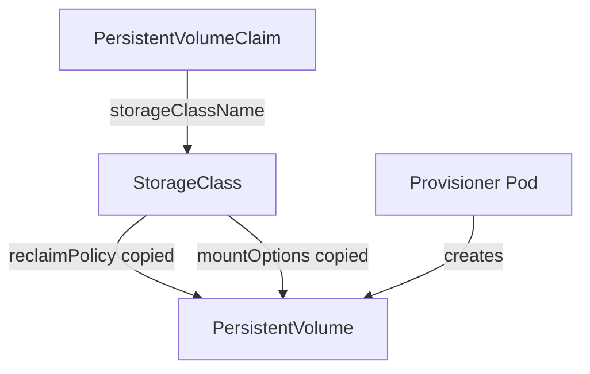

# StorageClass Fields And What They Control

An administrator who creates a StorageClass makes decisions for every claim that will use it later. The class is read at the moment a volume is created, and several of its values are copied into the new PersistentVolume (PV). This part reads the fields of a real class, creates a new one, and shows which fields the API server lets you change afterwards.

## The class that already exists

A StorageClass (API group `storage.k8s.io/v1`) is a cluster-scoped object, so it has no namespace. Start by reading the class that kind installs:

<!-- astrona:playground:renew -->

```sh
kubectl get storageclass standard -o yaml
```

Look for these top-level fields: `provisioner`, `reclaimPolicy`, `volumeBindingMode` and the annotation `storageclass.kubernetes.io/is-default-class`. There is no `spec` section. A StorageClass keeps its settings at the top level of the object.

The `provisioner` field names the component that creates volumes. The value `rancher.io/local-path` identifies the local-path provisioner, a controller Pod that runs in the cluster and creates a directory on a node for each claim. The name does not select software by itself. A Pod that serves that name must be running, or no volume is created.

## What each field does

`provisioner` is required. It is matched by name against the controllers that watch for claims. For a Container Storage Interface (CSI) driver the name is the driver name, for example `ebs.csi.aws.com`.

`parameters` is a map of strings that Kubernetes passes to the provisioner without reading it. Each provisioner defines its own keys, such as a disk type or a file system. A key the provisioner does not know usually makes provisioning fail.

`reclaimPolicy` is `Delete` or `Retain`. The default is `Delete`. When a volume is created, Kubernetes copies this value into the PV field `persistentVolumeReclaimPolicy`. Changing the class later does not change PVs that already exist.

`volumeBindingMode` is `Immediate` or `WaitForFirstConsumer`. The default is `Immediate`: the volume is created as soon as the claim exists. With `WaitForFirstConsumer` the claim stays `Pending` until a Pod that uses it is created, and the scheduler picks the node first.

`allowVolumeExpansion` is a boolean. When it is `true`, a user can increase `spec.resources.requests.storage` on a bound claim. Kubernetes never shrinks a volume.

`mountOptions` is a list of options that Kubernetes copies into the `mountOptions` of each PV the class creates. The API server does not check the options. An option that the volume type does not support makes the mount fail when a Pod starts.

`allowedTopologies` limits the topology segments, such as zones, where a volume may be created. It matters only for storage that exists in some places and not in others.

## Create a class with explicit values

Save this as `storageclass-training-archive.yaml`:

```yaml
apiVersion: storage.k8s.io/v1
kind: StorageClass
metadata:
  name: training-archive
provisioner: rancher.io/local-path
reclaimPolicy: Retain
volumeBindingMode: WaitForFirstConsumer
allowVolumeExpansion: true
```

Apply it:

```sh
kubectl apply -f storageclass-training-archive.yaml
```

Then check the result. The custom columns show the three fields that change behavior most:

```sh
kubectl get storageclass training-archive -o custom-columns=NAME:.metadata.name,PROVISIONER:.provisioner,RECLAIM:.reclaimPolicy,BINDING:.volumeBindingMode,EXPAND:.allowVolumeExpansion
```

The row shows `rancher.io/local-path`, `Retain`, `WaitForFirstConsumer` and `true`.

## A claim waits for its first consumer

Save this as `persistentvolumeclaim-archive-data.yaml`:

```yaml
apiVersion: v1
kind: PersistentVolumeClaim
metadata:
  name: archive-data
  namespace: starfleet
spec:
  storageClassName: training-archive
  accessModes:
  - ReadWriteOnce
  resources:
    requests:
      storage: 64Mi
```

Apply it and read its phase:

```sh
kubectl apply -f persistentvolumeclaim-archive-data.yaml
kubectl -n starfleet get pvc archive-data
```

The claim stays `Pending`. This is correct for `WaitForFirstConsumer`: no Pod uses the claim yet, so the scheduler has no node to give the provisioner. Save this Pod as `pod-archive-writer.yaml`:

```yaml
apiVersion: v1
kind: Pod
metadata:
  name: archive-writer
  namespace: starfleet
spec:
  containers:
  - name: writer
    image: docker.io/library/busybox:1.37.0
    command: ["sh", "-c", "echo stored > /data/note.txt && sleep 3600"]
    volumeMounts:
    - name: data
      mountPath: /data
  volumes:
  - name: data
    persistentVolumeClaim:
      claimName: archive-data
```

Apply it, wait for the claim to bind, and read the policy on the new PV:

```sh
kubectl apply -f pod-archive-writer.yaml
kubectl -n starfleet wait --for=jsonpath='{.status.phase}'=Bound pvc/archive-data --timeout=120s
kubectl get pv -o custom-columns=NAME:.metadata.name,CLAIM:.spec.claimRef.name,RECLAIM:.spec.persistentVolumeReclaimPolicy
```

The row for `archive-data` shows `Retain`. The provisioner copied the class value into the PV. The PV for a claim on `standard` would show `Delete`.

## Which fields cannot change

The API server rejects updates to `provisioner`, `parameters`, `reclaimPolicy` and `volumeBindingMode` on an existing class. Try one:

```sh
kubectl patch storageclass training-archive --type merge -p '{"reclaimPolicy":"Delete"}'
```

The command fails with a validation error from the API server. The fields `allowVolumeExpansion` and `mountOptions` can change. To change an immutable field, delete the class and create it again. Deleting a class does not delete the PVs and claims it created. Existing claims keep working because the PV already holds a copy of the values.



The diagram shows that the class is read when the volume is created, and that its values then live in the PV.

You now know what each field does and which ones are fixed once the class exists. The next question is how a claim without a class name finds one.

## Common pitfalls

> [!WARNING]
> `reclaimPolicy` on a class affects only PVs created after it. A PV already created keeps the policy it was given. Do not expect `mountOptions` to be validated: a bad option shows up only when a Pod mounts the volume.
