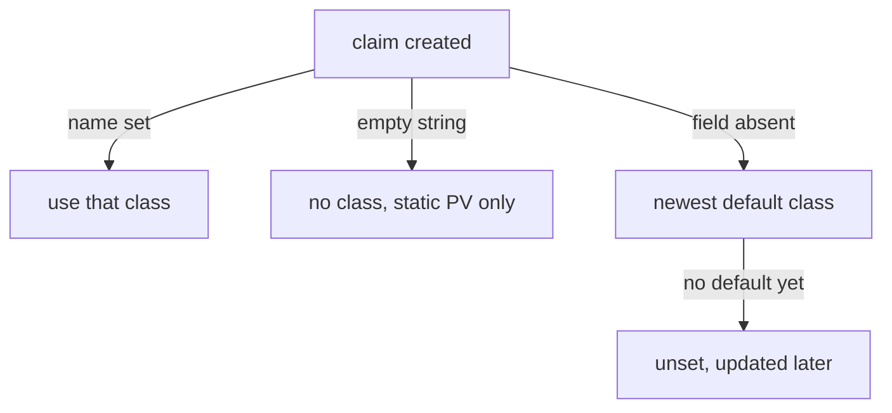

# The Default StorageClass And Claim Class Selection

Many manifests do not name a StorageClass. A Helm chart, a StatefulSet template or a quick test claim often asks only for a size. Kubernetes must still decide which class creates the volume, and a wrong decision means data on the wrong kind of storage or a claim that never binds. This part shows the mechanism that picks the class and the three ways a claim can name, omit or empty the class.

## Three values of storageClassName

The field `spec.storageClassName` of a PersistentVolumeClaim (PVC) has three states, and they behave differently:

- A name, such as `training-fast`: the claim uses that class. If the class does not exist, the claim stays `Pending`.
- The field is absent: the claim gets the default class.
- An empty string, `""`: the claim asks for no class at all. Only a PersistentVolume (PV) with an empty class can satisfy it, and no provisioner creates a volume for it.

The default class is the StorageClass that carries the annotation `storageclass.kubernetes.io/is-default-class: "true"`. An admission controller in the API server, named `DefaultStorageClass`, reads that annotation when a claim is created and writes the class name into the claim.

## See the default class

List the classes in the playground:

<!-- astrona:playground:renew -->

```sh
kubectl get storageclass
```

The class `standard` shows `(default)` after its name. The class `training-fast` does not. Save this claim, which names no class, as `persistentvolumeclaim-notes.yaml`:

```yaml
apiVersion: v1
kind: PersistentVolumeClaim
metadata:
  name: notes
  namespace: starfleet
spec:
  accessModes:
  - ReadWriteOnce
  resources:
    requests:
      storage: 32Mi
```

Apply it and read the class that the API server stored in the claim:

```sh
kubectl apply -f persistentvolumeclaim-notes.yaml
kubectl -n starfleet get pvc notes -o jsonpath='{.spec.storageClassName}{"\n"}'
```

The command prints `standard`. The manifest never contained that name. The admission controller added it at creation time.

## An empty string disables the default

Save this claim as `persistentvolumeclaim-static-only.yaml`:

```yaml
apiVersion: v1
kind: PersistentVolumeClaim
metadata:
  name: static-only
  namespace: starfleet
spec:
  storageClassName: ""
  accessModes:
  - ReadWriteOnce
  resources:
    requests:
      storage: 32Mi
```

Apply it and read the field:

```sh
kubectl apply -f persistentvolumeclaim-static-only.yaml
kubectl -n starfleet get pvc static-only -o jsonpath='[{.spec.storageClassName}]{"\n"}'
```

The brackets show an empty value. The default class was not applied. The claim stays `Pending` until an administrator creates a PV with an empty class that fits it. An empty string is how you ask for a manually created PV on a cluster that has a default class.

## Change which class is the default

Only the annotation decides which class is the default, so you move the default by editing annotations. Save this class as `storageclass-training-default.yaml`:

```yaml
apiVersion: storage.k8s.io/v1
kind: StorageClass
metadata:
  name: training-default
  annotations:
    storageclass.kubernetes.io/is-default-class: "true"
provisioner: rancher.io/local-path
volumeBindingMode: WaitForFirstConsumer
```

Apply it:

```sh
kubectl apply -f storageclass-training-default.yaml
```

The cluster now has two classes with the annotation set to `"true"`. Kubernetes allows this. When a new claim names no class, it chooses the default class that was created most recently, here `training-default`. Check with a second claim. Save it as `persistentvolumeclaim-notes-two.yaml`:

```yaml
apiVersion: v1
kind: PersistentVolumeClaim
metadata:
  name: notes-two
  namespace: starfleet
spec:
  accessModes:
  - ReadWriteOnce
  resources:
    requests:
      storage: 32Mi
```

Apply it and compare the two claims:

```sh
kubectl apply -f persistentvolumeclaim-notes-two.yaml
kubectl -n starfleet get pvc notes notes-two -o custom-columns=NAME:.metadata.name,CLASS:.spec.storageClassName
```

`notes` keeps `standard` and `notes-two` shows `training-default`. A class chosen at creation never changes when the default moves. To leave only one default, set the old annotation to `"false"`:

```sh
kubectl patch storageclass standard -p '{"metadata":{"annotations":{"storageclass.kubernetes.io/is-default-class":"false"}}}'
```

Run `kubectl get storageclass` again. Only `training-default` shows `(default)`.

## A claim created before any default exists

If no class is the default when a claim without `storageClassName` is created, the claim is stored with the field unset and stays `Pending`. When an administrator later marks a class as the default, the control plane updates those unset claims with the new class. Claims with `""` are never updated.



The diagram shows the four outcomes for the value of `storageClassName`.

You now know how the class of a claim is chosen. The next step is to find out why a claim with a valid class can still wait.

## Common pitfalls

> [!WARNING]
> Two default classes are accepted without an error, so the problem shows up later as claims on the wrong storage. Keep exactly one default. Do not use `""` when you want the default class; omit the field instead.
