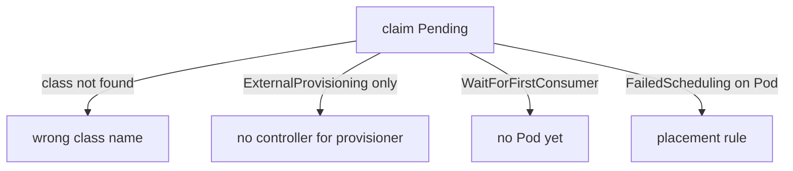

# Reading A Pending Claim

The phase `Pending` says only that a claim has no volume yet. It does not say why. The reason is written as events on the claim by the components that tried to bind it. This part lists the components that take part in binding, the events each one writes, and the evidence that separates the four common causes.

## Which component does what

Three components decide the fate of a claim. The PV controller, part of the kube-controller-manager, watches claims and binds each one to a PersistentVolume (PV) or asks for one to be created. The external provisioner is a controller that runs as a Pod and creates volumes for one provisioner name, for example `rancher.io/local-path`. The scheduler picks a node for a Pod, and with `WaitForFirstConsumer` it also tells the provisioner which node was picked.

A claim is therefore Pending while one of these is true: its class is missing, nobody serves the class provisioner name, no Pod has asked for it yet, or the scheduler cannot place the Pod. The playground contains one claim for each of the first three.

## List the claims and the classes

List all claims in `starfleet` and every class:

<!-- astrona:playground:renew -->

```sh
kubectl -n starfleet get pvc
kubectl get storageclass
```

Three claims have the phase `Pending`: `orphan-data`, `offline-data` and `wait-data`. The class list shows `standard` as the default and a class `training-offline`. There is no class named `standard-fast`.

## Cause 1: the class does not exist

Describe the first claim and read the events at the bottom:

```sh
kubectl -n starfleet describe pvc orphan-data
```

The claim names the class `standard-fast`. The event is written by the PV controller. It says that the class was not found, with its name. No provisioner can act, because no class says which provisioner to use. Compare the field and the class list:

```sh
kubectl -n starfleet get pvc orphan-data -o jsonpath='{.spec.storageClassName}{"\n"}'
```

A claim whose class name is spelled wrong, or whose class was deleted, always ends up here.

## Cause 2: nobody serves the provisioner name

Describe the second claim:

```sh
kubectl -n starfleet describe pvc offline-data
```

The claim names `training-offline`, and that class exists. Its provisioner is `example.com/no-such-provisioner`. Because a Pod uses the claim, the binding mode does not hold it back. The event with the reason `ExternalProvisioning` says that the claim waits for a volume to be created by the external provisioner with that name, or manually by an administrator. The class is valid. What is missing is a controller that serves the name.

Check which provisioner the class asks for:

```sh
kubectl get storageclass training-offline -o jsonpath='{.provisioner}{"\n"}'
```

A controller that creates volumes for a name writes the events `Provisioning` and `ProvisioningSucceeded` on the claim. When only `ExternalProvisioning` appears and nothing follows, no controller picked the claim up.

## Cause 3: WaitForFirstConsumer with no Pod

Describe the third claim:

```sh
kubectl -n starfleet describe pvc wait-data
```

The class is `standard`, and its binding mode is `WaitForFirstConsumer`. The event has the reason `WaitForFirstConsumer` and says the claim waits for a first consumer. This is not an error. No Pod uses `wait-data`, so the scheduler has no node yet. Create a Pod that mounts the claim and the claim binds.

You can tell this cause from cause 2 by the event reason and by the question "is a Pod using the claim?". A claim with this event and a Pod that is also Pending points to the scheduler instead.

## Cause 4: the Pod cannot be placed

With `WaitForFirstConsumer`, the node must satisfy the Pod and the volume together. A Pod with a `nodeSelector` that no node matches stays unscheduled, so the claim waits too. A class with `allowedTopologies` that lists a zone where no node exists has the same result. Read the Pod events for this cause. The scheduler writes the reason `FailedScheduling` on the Pod and lists what did not match:

```sh
kubectl -n starfleet describe pod orphan-writer
```

In the playground this Pod is unscheduled because its claim is not usable. Read the message of the `FailedScheduling` event. It points at a claim that is not bound, not at a lack of CPU or memory.

## Events across the namespace

Events live for a short time. List all events of the namespace in time order to see which component wrote what:

```sh
kubectl -n starfleet get events --sort-by=.lastTimestamp
```



The diagram maps each evidence to its cause.

You can now say why a claim is Pending from its events. The next question is how to repair each cause when some fields cannot be edited.

## Common pitfalls

> [!WARNING]
> Do not restart the Pod or the node for a Pending claim. Read the claim events first. A claim waiting under `WaitForFirstConsumer` is healthy until a Pod uses it.
