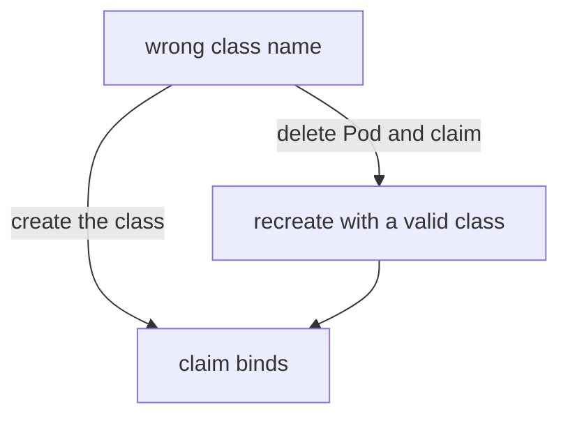

# Repairing A Pending Claim

Once the cause of a Pending claim is known, the fix depends on which field is wrong and whether Kubernetes allows that field to change. Most of a claim's `spec` is fixed after creation. This part shows which edits the API server accepts, which it rejects, and the two repair routes: create what the claim expects, or replace the claim.

## What a claim lets you edit

After a PVC is created, the API server accepts changes to `spec.resources.requests` (to grow a volume, when the class allows it) and a few later fields. It rejects changes to `storageClassName`, `accessModes`, `volumeName` and `volumeMode` once the claim exists. A Pod behaves the same way: the volume list of a Pod cannot be changed in place. The repair of a wrong class name is therefore never an edit of the claim.

The playground has a claim `orphan-data` that names a class `standard-fast` that does not exist. Try the edit and read the rejection:

<!-- astrona:playground:renew -->

```sh
kubectl -n starfleet patch pvc orphan-data --type merge -p '{"spec":{"storageClassName":"standard"}}'
```

The API server answers with an error that says the claim spec is immutable. The claim is unchanged. Confirm that it still names the old class:

```sh
kubectl -n starfleet get pvc orphan-data -o jsonpath='{.spec.storageClassName}{"\n"}'
```

## Route 1: create the missing object

If the name in the claim is the intended one, create the object it expects. A class named `standard-fast` would satisfy the claim without touching the claim or the Pod. Save this as `storageclass-standard-fast.yaml`:

```yaml
apiVersion: storage.k8s.io/v1
kind: StorageClass
metadata:
  name: standard-fast
provisioner: rancher.io/local-path
volumeBindingMode: WaitForFirstConsumer
```

Apply it:

```sh
kubectl apply -f storageclass-standard-fast.yaml
```

The Pod `orphan-writer` already uses the claim. The scheduler retries the Pod, picks a node, and the local-path provisioner creates the volume. Wait and check:

```sh
kubectl -n starfleet wait --for=jsonpath='{.status.phase}'=Bound pvc/orphan-data --timeout=120s
kubectl -n starfleet get pod orphan-writer
```

Use this route when the claim name is correct and the class was missing or deleted by mistake.

## Route 2: replace the claim

If the class in the claim is wrong, delete the claim and create it again with the right class. A claim in use is protected: Kubernetes does not remove it while a Pod uses it. Delete the Pod first, then the claim. The claim `offline-data` names the class `training-offline`, whose provisioner has no controller, and the class cannot be edited because its `provisioner` field is fixed. Delete the Pod and the claim:

```sh
kubectl -n starfleet delete pod offline-writer
kubectl -n starfleet delete pvc offline-data
```

Save the replacement as `workload-offline.yaml`. It uses the class `standard`, which has a running provisioner:

```yaml
apiVersion: v1
kind: PersistentVolumeClaim
metadata:
  name: offline-data
  namespace: starfleet
spec:
  storageClassName: standard
  accessModes:
  - ReadWriteOnce
  resources:
    requests:
      storage: 64Mi
---
apiVersion: v1
kind: Pod
metadata:
  name: offline-writer
  namespace: starfleet
spec:
  containers:
  - name: writer
    image: docker.io/library/busybox:1.37.0
    command: ["sh", "-c", "echo ok > /data/ok.txt && sleep 3600"]
    volumeMounts:
    - name: data
      mountPath: /data
  volumes:
  - name: data
    persistentVolumeClaim:
      claimName: offline-data
```

Apply it and wait for the Pod:

```sh
kubectl apply -f workload-offline.yaml
kubectl -n starfleet wait --for=condition=Ready pod/offline-writer --timeout=180s
```

Deleting a claim with the default reclaim policy `Delete` removes its volume. Nothing was stored in this one, so no data is lost. When a claim holds data, check the reclaim policy of its volume before you delete it.

## Look at the provisioner

When a class is correct and the claim still does not bind after a Pod uses it, read the provisioner. In kind, the local-path provisioner runs in the namespace `local-path-storage`:

```sh
kubectl -n local-path-storage get pods
kubectl -n local-path-storage logs deploy/local-path-provisioner --tail=20
```

The log lines name each claim it provisions. A provisioner that is not running, crashing or unable to reach its storage shows up here and as events on the claim. A class whose provisioner name nobody serves leaves no log line anywhere, because no Pod exists to write one.



The diagram shows the two repair routes for a wrong class.

You can now repair a claim and know why the edit is refused. A claim that binds can still fail at the Pod, but that is a separate question.

## Common pitfalls

> [!WARNING]
> Deleting a claim deletes its volume when the policy is `Delete`. A claim that is still used by a Pod stays in the phase `Terminating` until the Pod is gone. Do not remove finalizers by hand to force a delete.
