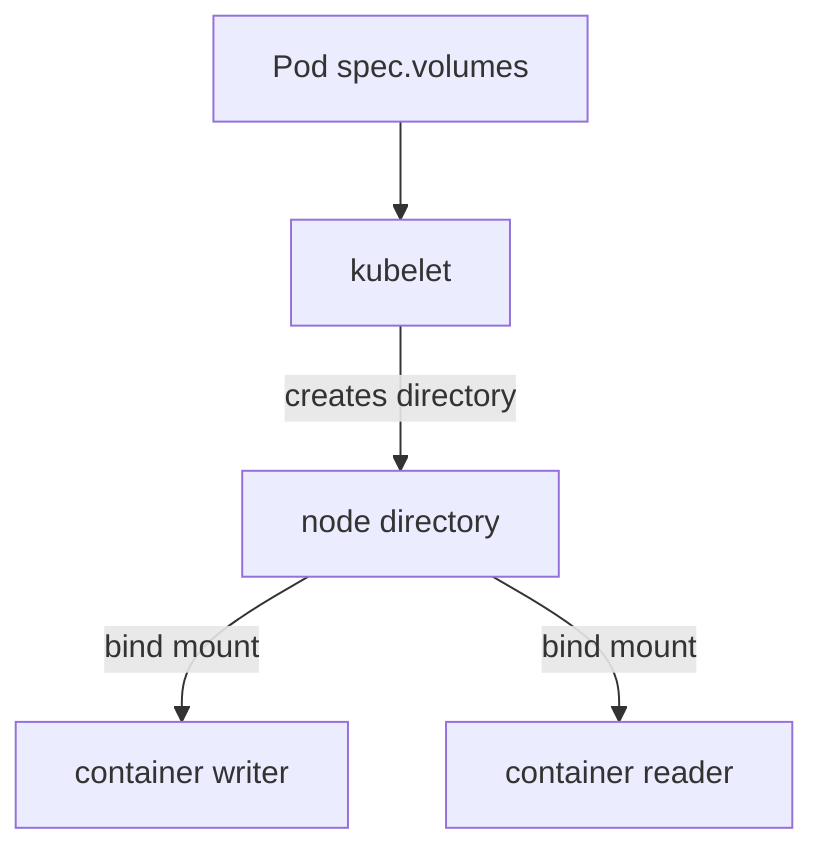

# Scratch Space And Node Paths

A container writes to its own filesystem layer, and that layer disappears when the container restarts. Two containers of the same Pod also cannot see each other's files. A volume solves both problems. This part covers the three volume types that give a Pod a directory without a PersistentVolumeClaim: `emptyDir`, `hostPath` and the `subPath` mount option.

## How a volume reaches a container

A volume is declared once in `spec.volumes` of the Pod and mounted with `volumeMounts` in each container that needs it. The kubelet, the agent that runs on each node, prepares the directory on the node before it starts the containers. The container runtime (containerd in a kind node) then bind-mounts that directory into each container.



The diagram shows that one node directory backs both containers, so a file written by one container is visible to the other.

The mount name in `volumeMounts` must equal a volume name in `spec.volumes`. A mismatch makes the API server reject the Pod.

## emptyDir

An `emptyDir` volume is created empty when the Pod is assigned to a node, and the kubelet deletes it when the Pod is removed from that node. It survives a container restart, because the Pod stays on the node. It does not survive Pod deletion or replacement. Data that must outlive the Pod does not belong here.

Save this as `pod-relay.yaml`:

```yaml
apiVersion: v1
kind: Pod
metadata:
  name: relay
  namespace: starfleet
spec:
  containers:
    - name: writer
      image: docker.io/library/busybox:1.37.0
      command: ["sh", "-c", "sleep 3600"]
      volumeMounts:
        - name: spool
          mountPath: /spool
    - name: reader
      image: docker.io/library/busybox:1.37.0
      command: ["sh", "-c", "sleep 3600"]
      volumeMounts:
        - name: spool
          mountPath: /spool
          readOnly: true
  volumes:
    - name: spool
      emptyDir:
        medium: Memory
        sizeLimit: 32Mi
```

<!-- astrona:playground:renew -->

Apply it:

```sh
kubectl apply -f pod-relay.yaml
```

Then write a file in `writer` and read it in `reader`:

```sh
kubectl -n starfleet wait --for=condition=Ready pod/relay --timeout=120s
kubectl -n starfleet exec relay -c writer -- sh -c 'echo ping > /spool/message'
kubectl -n starfleet exec relay -c reader -- cat /spool/message
```

The last command prints `ping`. The `reader` container mounts the volume with `readOnly: true`, so a write from `reader` fails with a read-only filesystem error, while `writer` can write.

The field `medium` selects where the data lives. An empty `medium` (the default) stores the data on the node's disk. `medium: Memory` mounts a `tmpfs`, a filesystem held in RAM. Data in `tmpfs` is never written to disk and is lost when the node restarts, but it counts against the memory of the container that writes it. The field `sizeLimit` caps the volume. For a memory-backed volume the kubelet sets the size of the `tmpfs` to the limit. For a disk-backed volume the kubelet measures usage periodically and evicts the Pod when usage passes the limit, so the cap is enforced after the fact and not by the filesystem.

## hostPath

A `hostPath` volume mounts a file or directory of the node's own filesystem into the Pod. The data belongs to the node, not to the Pod, so it survives Pod deletion. It is also visible only on that node: if the Pod is rescheduled to another node, it sees a different directory.

The field `type` tells the kubelet what to check before it mounts the path. `""` (the default) checks nothing. `DirectoryOrCreate` and `FileOrCreate` create the path with mode `0755` and `0644` if it is missing. `Directory`, `File`, `Socket`, `CharDevice` and `BlockDevice` require that the path already exists with that type, and the Pod stays in `ContainerCreating` when it does not.

A `hostPath` volume gives a container access to the node. A path such as `/var/run` or `/etc` exposes node files and, with a write mount, lets a compromised container change them. Use `hostPath` for node agents that must read node files, and for single-node practice clusters. Use a PersistentVolumeClaim for application data.

## subPath

By default a mount exposes the whole volume at `mountPath`. The `subPath` option mounts one directory or file of the volume instead, so several containers can use different directories of one volume without seeing each other's.

```yaml
      volumeMounts:
        - name: spool
          mountPath: /spool/writer
          subPath: writer
```

The kubelet creates the sub-directory when it does not exist. A `subPath` mount is bound once when the container starts. A later change of the volume source (for a ConfigMap or Secret volume) is not delivered through that mount, which the next part explains.

You now know three ways a Pod gets a directory without a claim, and how long each one lasts. A directory that holds configuration needs more than a path: it must be filled from a Kubernetes object, which is the next problem.

## Common pitfalls

> [!WARNING]
> `emptyDir` data is deleted with the Pod, and a `medium: Memory` volume uses container memory, so a large file can cause the container to be killed for exceeding its memory limit. A `hostPath` mount gives the Pod access to the node, and its data exists only on one node. A `subPath` mount does not receive updates to a ConfigMap or Secret.
