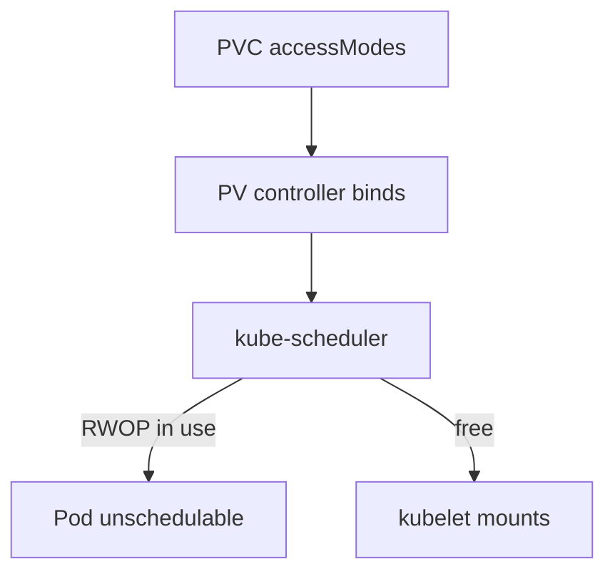

# Volume Modes And Access Modes

A claim carries two properties that decide how a Pod may use the storage behind it: the volume mode, which sets the shape of the data a container sees, and the access modes, which set who may attach and write. Both are matched against the PersistentVolume during binding. A mismatch leaves the claim Pending, so you need to read both before you write a claim.

## Volume mode

The field `volumeMode` appears on both the PV and the PVC. It has two values. `Filesystem`, the default, means the volume is mounted as a directory with a filesystem on it. The kubelet formats an empty block device with a filesystem on first use when the driver needs that. `Block` means the container gets the raw block device, with no filesystem.

A Pod mounts a `Filesystem` volume with `volumeMounts` and `mountPath`. A Pod uses a `Block` volume with `volumeDevices` and `devicePath`, which is the path of the device file inside the container.

```yaml
      volumeDevices:
        - name: data
          devicePath: /dev/xvda
```

A claim with `volumeMode: Block` binds only to a PV with `volumeMode: Block`, and a `Filesystem` claim binds only to a `Filesystem` PV. Raw block volumes suit applications that manage the device themselves, such as a database that writes its own layout. The provisioner in the practice cluster (`rancher.io/local-path`) supports `Filesystem` only, so a `Block` claim there does not provision. This module therefore does not run a `Block` exercise.

## The four access modes

An access mode is a list in `spec.accessModes` of the claim and of the PV. A PV can list several modes, but a mounted volume uses one at a time.

- `ReadWriteOnce` (RWO): one node may mount the volume read-write. Several Pods on that same node can all use it.
- `ReadOnlyMany` (ROX): many nodes may mount the volume read-only.
- `ReadWriteMany` (RWX): many nodes may mount the volume read-write.
- `ReadWriteOncePod` (RWOP): one Pod in the whole cluster may use the volume, read-write.

The modes describe the capability of the volume. The storage driver decides which modes it supports. A driver for a network filesystem often supports RWX. A driver for a block disk attached to one machine supports RWO and often RWOP, but not RWX. A claim that asks for a mode the driver cannot offer stays Pending, or its provisioner reports an error.

## Who enforces what

For RWO, ROX and RWX, the node-level enforcement happens when a volume is attached or mounted. The attach and mount operations belong to the driver and the kubelet, and the volume is attached to nodes, so the limit is per node. Kubernetes documents that RWO does not stop two Pods on the same node from using one volume.

For RWOP, the kube-scheduler adds a check. The scheduler plugin `VolumeRestrictions` looks at every Pod that uses the claim. If a claim with `ReadWriteOncePod` is already used by another Pod, the scheduler marks the new Pod unschedulable. Kubernetes documents `ReadWriteOncePod` support for CSI volumes. The Container Storage Interface (CSI) is the standard interface between Kubernetes and a storage driver. The exercises here use hostPath volumes to observe the scheduler check, which reads the claim's access modes and not the driver.



The diagram shows that binding matches the modes first, and the scheduler then decides whether a Pod may be placed at all.

## Binding matches the modes

A PV and a PVC bind only when the PV lists every access mode that the claim requests. Look at the starting objects in the playground.

<!-- astrona:playground:renew -->

```sh
kubectl get pv playground-single playground-shared -o custom-columns=NAME:.metadata.name,MODES:.spec.accessModes,CLASS:.spec.storageClassName,PHASE:.status.phase
```

Both volumes are `Available`. Save this as `pvc-single-writer.yaml`:

```yaml
apiVersion: v1
kind: PersistentVolumeClaim
metadata:
  name: single-writer
  namespace: starfleet
spec:
  accessModes:
    - ReadWriteOncePod
  storageClassName: ""
  resources:
    requests:
      storage: 64Mi
```

Apply it:

```sh
kubectl apply -f pvc-single-writer.yaml
```

Then check what it bound to:

```sh
kubectl -n starfleet get pvc single-writer -o jsonpath='{.status.phase} {.spec.volumeName}{"\n"}'
```

The claim binds to `playground-single`, the only volume that lists `ReadWriteOncePod`. The empty `storageClassName` keeps the default class from provisioning a new volume. A claim that asked for `ReadWriteMany` would stay Pending against both volumes, because neither lists that mode.

You now know how the modes decide which volume a claim binds to and who limits use afterwards. What a Pod experiences when the limit is reached is the next question.

## Common pitfalls

> [!WARNING]
> `ReadWriteOnce` limits a volume to one node, not one Pod. A `Block` volume is not mounted: use `volumeDevices`, not `volumeMounts`. A claim with `storageClassName` omitted can be given the default class and a new dynamic volume instead of binding the static PV you intended; use `""` to opt out.
