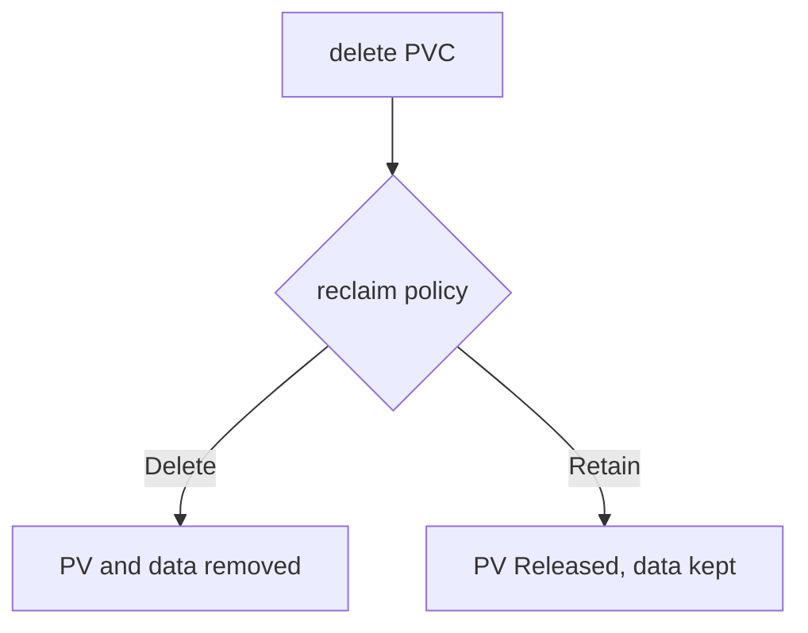

# Reclaim Policy And Claim Deletion

A team deletes a claim and expects its data to go away, or expects it to stay. Both expectations are wrong half of the time, because the outcome depends on a field of the PV, not of the claim. This part follows one dynamically provisioned volume through claim deletion under each policy, and shows the step that must happen before the delete if the data has to survive.

## Where the policy comes from

The field `persistentVolumeReclaimPolicy` lives on the PV. A dynamic provisioner creates the PV and copies the policy from the `reclaimPolicy` field of the StorageClass, which defaults to `Delete`. A static PV that an administrator writes by hand defaults to `Retain`. The two values that matter are:

- `Delete`: when the claim is deleted, the PV controller deletes the PV object, and the provisioner removes the backing storage.
- `Retain`: when the claim is deleted, the PV object and the data stay. The PV moves to the phase `Released`.

The PV controller, a loop inside the kube-controller-manager, performs the transition. The external provisioner (in the practice cluster, `rancher.io/local-path`) performs the deletion of backing storage for `Delete`.



The diagram shows that one delete command on the claim leads to two different results, chosen by the PV.

## Read the policy of a bound volume

Find the PV behind the claim `scratch-data`. The claim's `spec.volumeName` holds its name.

<!-- astrona:playground:renew -->

```sh
kubectl -n starfleet get pvc scratch-data -o jsonpath='{.spec.volumeName}{"\n"}'
```

Use that name in the next command:

```sh
kubectl get pv <PV> -o custom-columns=NAME:.metadata.name,POLICY:.spec.persistentVolumeReclaimPolicy,PHASE:.status.phase,CLASS:.spec.storageClassName
```

Replace `<PV>` with the name from the first command. The policy is `Delete`, because the `standard` class in the practice cluster has the default `reclaimPolicy`. Read `kubectl get storageclass standard` to see that class's value.

## Change the policy before the delete

The policy of a bound PV is editable. This is the standard way to protect the data of a volume that was provisioned with `Delete`:

```sh
kubectl patch pv <PV> -p '{"spec":{"persistentVolumeReclaimPolicy":"Retain"}}'
```

The change must come before the claim is deleted. If the claim is deleted first under `Delete`, the PV controller removes the volume at once, and a later patch has nothing to patch. The StorageClass field `reclaimPolicy` only sets the value for volumes created afterwards, and editing the class does not change existing PVs.

## A claim in use is not deleted at once

A delete of a claim that a running Pod uses does not remove it immediately. The API server sets `metadata.deletionTimestamp` on the claim, and the finalizer `kubernetes.io/pvc-protection` keeps the object until no Pod uses it. A finalizer is a name in `metadata.finalizers` that blocks the removal of an object until a controller removes the name. Try it:

```sh
kubectl -n starfleet delete pvc scratch-data --wait=false
kubectl -n starfleet get pvc scratch-data -o jsonpath='{.metadata.deletionTimestamp} {.metadata.finalizers}{"\n"}'
```

The claim stays with a deletion timestamp and the finalizer `kubernetes.io/pvc-protection` while `scratch-writer` runs. Remove the Pod and the claim leaves:

```sh
kubectl -n starfleet delete pod scratch-writer
```

The PV controller then handles the PV according to the policy. A PV has a similar finalizer, `kubernetes.io/pv-protection`, which keeps a PV that is still bound to a claim from being removed.

The order for keeping data is therefore fixed: patch the PV to `Retain`, delete the Pod that uses the claim, then delete the claim. Check the PV after the last step:

```sh
kubectl get pv <PV> -o custom-columns=NAME:.metadata.name,POLICY:.spec.persistentVolumeReclaimPolicy,PHASE:.status.phase
```

A volume patched to `Retain` before the delete reports the phase `Released`. A volume left at `Delete` is gone, and the command reports that the PV is not found.

## Choose the policy when you create the class

A StorageClass sets the policy for every volume it provisions. A class meant for scratch data keeps `reclaimPolicy: Delete`, so deleted claims free their storage. A class meant for data that must outlive its claim sets `reclaimPolicy: Retain`.

Save this as `storageclass-keep.yaml`:

```yaml
apiVersion: storage.k8s.io/v1
kind: StorageClass
metadata:
  name: keep
provisioner: rancher.io/local-path
reclaimPolicy: Retain
volumeBindingMode: WaitForFirstConsumer
```

Apply it:

```sh
kubectl apply -f storageclass-keep.yaml
```

A claim that names `storageClassName: keep` gets a PV with `Retain`. The `reclaimPolicy` of an existing class cannot be changed. The API server rejects an update to that field, so a different policy needs a new class. Existing volumes keep the policy they were created with.

You now know where the policy is stored, how to change it in time and why a claim in use lingers. The PV that remains after `Retain` is not yet useful, and the next part shows why.

## Common pitfalls

> [!WARNING]
> Patch the PV, not the StorageClass: editing the class does not change volumes that already exist. Patch before you delete the claim, because `Delete` removes the volume as soon as the claim is gone. A claim stuck in `Terminating` means a Pod still uses it, so remove the Pod and do not remove the finalizer by hand.
