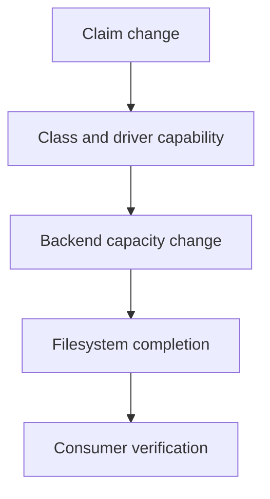

# Binding, Expansion And Administrative Storage Decisions

A claim asks for a larger filesystem, but its provisioner does not support expansion. Editing requested capacity cannot create a missing backend capability. Storage administration starts with the contract that the provisioner and volume actually support.

## Learning objectives

- Explain PV and PVC scope and matching.
- Distinguish static binding from dynamic allocation.
- Diagnose provisioning, attachment and mount stages.

## Before you start

This chapter is standalone reading material; no running cluster or installed tools are required. A Pod is the Kubernetes unit for running one or more containers, and a namespace groups namespaced objects. Treat the worked configurations as teaching examples rather than recorded observations from a provisioned environment.

## Responsible components and behavior

A PersistentVolume, or PV, represents cluster-managed storage capacity under a declared contract. A PersistentVolumeClaim, or PVC, requests suitable storage for a workload. The administrator connects those requests to provisioners, backend capabilities and lifecycle policy while preserving the intended application data requirements.

## Match Static Capacity Or Request Dynamic Provisioning

A statically supplied volume has fields such as capacity, access modes, volume mode and class that affect matching. A claim with incompatible requirements cannot be assumed to bind merely because the volume has a recognizable name. Explicit prebinding relationships can constrain selection, but they still require a supported and suitable contract.

A StorageClass can identify a dynamic provisioner and implementation parameters. A claim referencing it asks for storage under that class's rules. Specifying no class and explicitly requesting an empty class are not always equivalent when a default class is configured. Interpret the admitted claim and current defaults.

A volume is cluster-scoped, while a claim is namespaced. A Pod normally uses a claim from its own namespace. A similarly named claim in another namespace does not automatically satisfy that reference. Object existence and the intended ownership relationship must be checked together.

## Binding And Placement Can Interact

An immediate-binding class can provision or bind before the eventual consumer is placed. A `WaitForFirstConsumer` class can delay binding so consumer scheduling constraints and storage topology influence the decision. A Pending claim can therefore reflect expected coordination rather than a provisioner outage.

Topology matters for local or zonal storage. A volume available only to certain nodes or locations must fit the consumer's placement. Adding an affinity rule that excludes every suitable storage location can leave otherwise valid workload and claim definitions unable to produce a running Pod.

Forcing a particular node through settings that bypass ordinary scheduler placement can also disrupt the coordination expected by delayed binding. Read both the storage binding mode and workload placement contract before replacing the class or assuming more raw capacity is the solution.

## Expansion Has A Supported Path

Increasing a claim's requested capacity can initiate supported volume expansion when the class allows it and the driver implements the needed capabilities. Backend expansion and filesystem expansion are separate operations. The claim and workload observations should describe whether the added capacity is actually usable.

Editing a volume's capacity field directly is not a universal substitute for the supported claim expansion workflow. It can make declared state diverge from actual backend capacity or interfere with the controller's expected operation. Never infer additional usable bytes solely from an edited object number.

Shrinking persistent storage is not generally the reverse of expansion through an ordinary reduced claim request. Recovery from an oversized request has version-specific supported procedures, not a universal assumption that lowering the field shrinks the underlying filesystem safely. The learning objective is to identify the supported lifecycle rather than invent a destructive shortcut.

## Retention And Data Recovery

A reclaim policy influences what happens after a volume is released from its claim. `Delete` can remove backing storage under the implementation's contract, while `Retain` preserves a resource that needs deliberate administrative handling. A retained volume is not automatically ready for safe reassignment to another application.

Ownership, residual data and backend cleanup must be considered before reuse. A new claim should not inadvertently expose an earlier tenant's data. Protection mechanisms can delay deletion while resources remain in use, but finalizer presence is not proof of a complete backup or indefinite retention guarantee.

For a failed storage operation, identify the stage: matching, provisioning, topology selection, attachment, mounting or expansion. Connect observations to the responsible controller or node agent. That layered explanation preserves important data requirements while selecting a correction appropriate to the actual failure.

## Work through the decision

Consider a bound claim that requests ten gibibytes and now needs twenty. The requested capacity, the volume's recorded capacity and the filesystem's usable capacity can change at different stages. The StorageClass must permit expansion, and the driver and backend must implement the requested operation.

Binding also establishes ownership and location constraints. A similarly named volume does not override incompatible access or topology requirements. Before a change, identify the claim, its bound volume, its class and the consumer. Afterward, distinguish accepted intent from backend resize and filesystem completion. Recovery planning remains necessary because increasing capacity does not restore deleted data.

Storage changes need compatible capabilities and evidence at each transition, not merely an updated request field.

Storage changes need compatible capabilities and evidence at each transition, not merely an updated request field.

## Common pitfalls

> [!WARNING]
> A Pending claim can be waiting for consumer placement, and edited capacity does not prove backend expansion. Review namespace references, topology, driver support and retention before changing storage lifecycle state.
