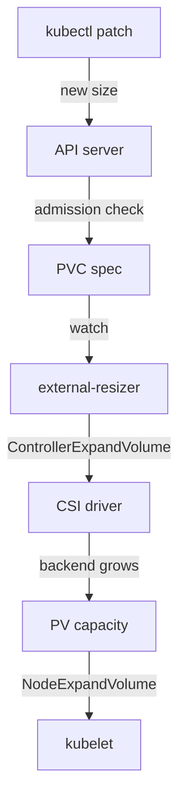

# Grow A Claim Through Its StorageClass

Applications fill their volumes. When a claim of 100Mi is nearly full, the usual fix is to make the same claim larger, because a new claim would start empty and the application would have to move its data. This part shows the one field that allows growth, the one edit that requests it, and the components that carry it out.

## The permission lives on the class

A StorageClass is the object that describes how a kind of storage is created. Its field `allowVolumeExpansion` is a boolean that says whether claims of this class may be made larger. When the field is missing or `false`, the API server refuses to raise the size of a bound claim that belongs to the class.

The playground has two classes that differ only in this field. Look at both:

<!-- astrona:playground:renew -->

```sh
kubectl get storageclass training-grow training-expand -o custom-columns=NAME:.metadata.name,PROVISIONER:.provisioner,EXPAND:.allowVolumeExpansion,BINDING:.volumeBindingMode
```

The column `EXPAND` is empty for `training-grow` and `true` for `training-expand`. Both use the provisioner `rancher.io/local-path`, which is the provisioner that the kind cluster ships. A provisioner is the component that creates the backing storage when a claim asks for it.

## The edit that requests growth

A claim states its size in `spec.resources.requests.storage`. To grow the claim, you change that one value to a larger one. You do not create a new claim and you do not touch the PV. The claim `logs` uses the class that allows expansion, so the edit is accepted by the API server.

Save this as `pvc-logs-patch.yaml`:

```yaml
spec:
  resources:
    requests:
      storage: 200Mi
```

Apply it as a patch:

```sh
kubectl -n starfleet patch pvc logs --patch-file pvc-logs-patch.yaml
```

Then read the claim back:

```sh
kubectl -n starfleet get pvc logs -o jsonpath='{.spec.resources.requests.storage}{"\n"}{.status.capacity.storage}{"\n"}'
```

The first line is the size that you requested, now `200Mi`. The second line is the size that the storage system reports. The two values are different fields on purpose, and the second one can lag behind the first or stay at the old value. The next part explains why.

## Who does the work

The API server only stores the new request. Other components act on it, in this order:



The diagram shows that one edit passes through the admission check, the resizer that talks to the driver, and the kubelet on the node.

The admission check is part of the API server. It compares the request with the class and refuses the edit when the class does not allow expansion. After that, the `external-resizer` is a sidecar container that runs next to a Container Storage Interface (CSI) driver. It watches claims, sees the larger request, and asks the driver to grow the volume in the storage system. The driver returns the new size, and the control plane writes it to the PV.

If the volume holds a file system, one more step is needed. The kubelet is the agent on each node. It grows the file system on the node when a Pod uses the claim. The kubelet does this only for the file systems that the platform can grow, which are XFS, ext3 and ext4, and only when a Pod mounts the claim read-write.

## Conditions and events show the progress

While the work runs, the claim carries conditions. `Resizing` means the controller side is growing the volume. `FileSystemResizePending` means the volume is larger and the file system on the node has not grown yet. Events on the claim record each step.

```sh
kubectl -n starfleet describe pvc logs
```

Read the `Conditions` and `Events` sections. In the playground the provisioner is a simple local-path provisioner and not a CSI driver with a resizer, so you cannot rely on `status.capacity` to change. What you can rely on is that the API server accepted the new request and that `spec` shows it.

## The status fields of a resize

Newer clusters record the state of a resize in the claim status. The field `status.allocatedResources` holds the size that the controller side has accepted so far. The map `status.allocatedResourceStatuses` holds a state for the storage resource, for example that the controller resize is in progress or that the node resize is pending.

You can print these fields to see whether a driver took the request:

```sh
kubectl -n starfleet get pvc logs -o jsonpath='{.status}{"\n"}'
```

An empty or unchanged status after the edit means that no component has acted on the request yet. That does not prove an error. It tells you which component to look at next, which is the driver and its resizer, not the claim.

## Two rules to remember

A claim can only grow. Kubernetes does not support a request below the current size, and the value must stay above what `status.capacity` already reports. The second rule is that the class belongs to the claim for its whole life. The field `storageClassName` of a claim cannot change, so you cannot move a claim to an expandable class. You change the class itself, which is the subject of the next part.

## Common pitfalls

> [!WARNING]
> Do not read `spec.resources.requests.storage` as the real size of the volume. It is the request. The real size is `status.capacity.storage`, and it changes only after the driver, and for file systems the kubelet, finished. Do not try to lower a request: the API server refuses a shrink.
