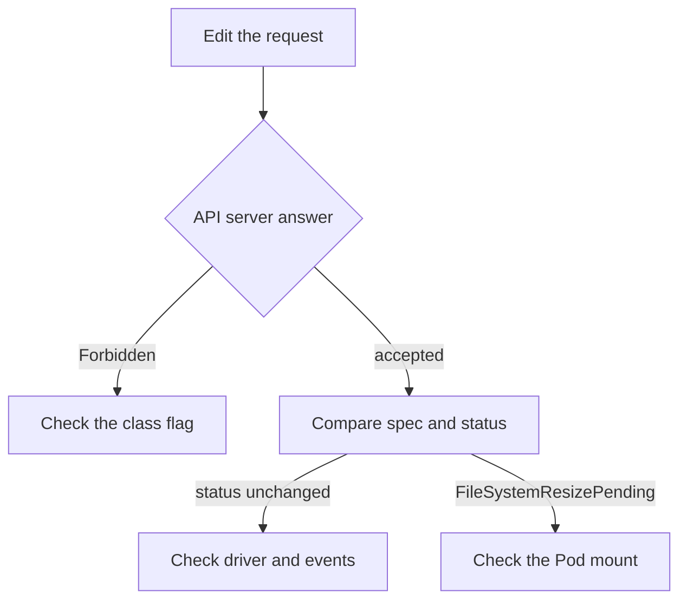

# When A Resize Is Refused Or Does Not Grow

A resize request has two outcomes that look alike to a beginner. Either the API server refuses the edit at once, or it accepts the edit and the volume does not grow. The causes and the fixes are different, so you must know which one you have. This part walks through the refusal, the class fix, and the cases where an accepted request still leads to no growth.

## A class that does not allow expansion

The claim `data` belongs to the class `training-grow`, which has no `allowVolumeExpansion`. Try to raise the size:

<!-- astrona:playground:renew -->

```sh
kubectl -n starfleet patch pvc data --type merge -p '{"spec":{"resources":{"requests":{"storage":"300Mi"}}}}'
```

The API server refuses the request and prints a `Forbidden` error. The message says that only dynamically provisioned claims can be resized and that the class which provisions the claim must support resize. The admission check in the API server produces this error, before any storage component sees the request. The claim keeps its old size.

The error names two conditions at once, and you have to find out which one fails. Read the class first:

```sh
kubectl get pvc data -n starfleet -o jsonpath='{.spec.storageClassName}{"\n"}'
kubectl get storageclass training-grow -o jsonpath='{.allowVolumeExpansion}{"\n"}'
```

The first command prints the class name of the claim. The second prints nothing, because the field is not set.

## Change the class, not the claim

The field `allowVolumeExpansion` is one of the few StorageClass fields that you can change after creation. Most other fields, such as `provisioner`, `parameters` and `reclaimPolicy`, cannot be updated, and you would have to delete and recreate the class. Changing the flag does not touch any existing volume. It only changes what the admission check allows from now on.

Save this as `storageclass-training-grow-patch.yaml`:

```yaml
allowVolumeExpansion: true
```

Apply it as a patch:

```sh
kubectl patch storageclass training-grow --patch-file storageclass-training-grow-patch.yaml
```

Then repeat the claim edit from before. This time the API server accepts it, and `spec.resources.requests.storage` of `data` shows `300Mi`.

```sh
kubectl -n starfleet get pvc data -o jsonpath='{.spec.resources.requests.storage}{"\n"}'
```

## Accepted, but the volume does not grow

The admission check only proves that the class allows growth. It does not prove that the storage system can grow. Three causes are common.

The first cause is a driver without resize support. For a CSI driver, expansion works only when the driver implements it and its `external-resizer` runs. A class that sets `allowVolumeExpansion: true` for such a driver is accepted by the API server, and the claim stays at its old `status.capacity`. The events of the claim then show that no resizer handled the request, or show nothing.

The second cause is the provisioner of the playground. It is `rancher.io/local-path`, a small provisioner that creates a directory on the node. It is not a CSI driver, and it does not resize a volume. In this environment you can verify the request in `spec`, and you cannot verify growth in `status.capacity`. A grading check for this task reads the class field and the claim request for that reason.

The third cause is a pending node step. The volume can be larger while the file system is not, and the claim then has the condition `FileSystemResizePending`. The kubelet grows the file system when a Pod mounts the claim read-write. A claim that no Pod uses can stay in this state.

## Static volumes are not resized by a controller

A claim bound to a PV that an administrator created by hand has no provisioner behind it. The check in the API server also refuses to resize such a claim, because it is not dynamically provisioned. To give the application more space, the administrator edits `spec.capacity.storage` of the PV, and only when the backing storage really is larger. The control plane does not verify this. Raising the number without growing the storage only makes the object lie.

```sh
kubectl get pv -o custom-columns=NAME:.metadata.name,CAPACITY:.spec.capacity.storage,CLASS:.spec.storageClassName,CLAIM:.spec.claimRef.name
```

Use this listing to see which volumes are bound to which claims before you decide where a size change belongs. A volume with a class of the provisioner is the one the claim can grow through.

## A short diagnosis order



The diagram shows that the answer of the API server decides whether you look at the class, the driver or the node.

When a resize does not work, ask these questions in order. Does the edit return an error? Then read the class field `allowVolumeExpansion` and whether the claim is dynamically provisioned. Is the edit accepted and `status.capacity` unchanged? Then read the events and conditions of the claim, and find out whether the driver supports resize. Is the capacity larger and the application still sees the old size? Then check for `FileSystemResizePending` and confirm that a Pod mounts the claim read-write.

You can now tell a refused request from an accepted one that did not finish, and you know that the fix for the first is on the class while the fix for the second is on the driver or the node.

## Common pitfalls

> [!WARNING]
> Do not delete and recreate a claim to get a larger size when data is on it. Do not edit the PV capacity of a dynamically provisioned volume to force growth: the controller owns that field. Setting `allowVolumeExpansion: true` on a class never proves that the driver can resize.
