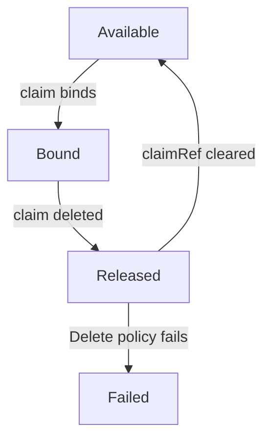

# How A Claim Finds Its Volume

An administrator has prepared three volumes of different sizes and labels. A team creates a claim. Which volume does the claim get? The answer is not "the first one" and not "the one with the closest name". The PersistentVolume controller, a control loop inside the controller manager, applies a fixed list of rules. This part lists the rules, shows how a selector steers the result, and explains how to reserve a volume for one claim.

## The rules a volume must satisfy

For every unbound claim, the controller looks for a PersistentVolume (PV) that meets all of these conditions:

- The PV has no claim yet, which means its phase is `Available`.
- The `storageClassName` of the PV is equal to the one of the claim. A claim with `storageClassName: ""` binds only to volumes whose class is also empty. The class name does not need a StorageClass object for static binding.
- The access modes of the claim are a subset of the access modes of the PV.
- The `volumeMode` is equal. Both default to `Filesystem`.
- The capacity of the PV is equal to or larger than the request of the claim.
- If the claim has a `selector`, the labels of the PV match it.

Among the volumes that pass, the controller picks the smallest one. If the best match is larger than the request, the claim gets the whole volume and the extra space is not usable by another claim. If no volume passes, the claim stays `Pending`, and the controller checks again when volumes or claims change.

Look at the volumes of the playground:

<!-- astrona:playground:renew -->

```sh
kubectl get pv --show-labels
```

You see `crate-a` and `crate-b` with 200Mi, and `vault-1` with 2Gi. All three have the status `Available`. The label column shows `tier=slow` for `crate-a`, `tier=fast` for `crate-b`, and no `tier` label for `vault-1`.

## One claim without a selector

Save this as `pvc-skiff.yaml`:

```yaml
apiVersion: v1
kind: PersistentVolumeClaim
metadata:
  name: skiff
  namespace: starfleet
spec:
  storageClassName: manual
  accessModes:
  - ReadWriteOnce
  resources:
    requests:
      storage: 100Mi
```

Apply it:

```sh
kubectl apply -f pvc-skiff.yaml
```

Then check which volume the claim got:

```sh
kubectl -n starfleet get pvc skiff -o jsonpath='{.spec.volumeName}{"\n"}'
kubectl get pv
```

Both `crate-a` and `crate-b` fit, because they have the same size, so the claim can bind to either. The control loop does not prefer a label. When two volumes are equally good, you cannot know in advance which one the claim gets. That is the reason to use a selector when the choice matters.

## Steer a claim with a selector

A `selector` in the claim filters the volumes by label. `matchLabels` requires an exact label value. `matchExpressions` uses the operators `In`, `NotIn`, `Exists` and `DoesNotExist`. All requirements are combined with AND.

Save this as `pvc-courier.yaml`:

```yaml
apiVersion: v1
kind: PersistentVolumeClaim
metadata:
  name: courier
  namespace: starfleet
spec:
  storageClassName: manual
  accessModes:
  - ReadWriteOnce
  selector:
    matchLabels:
      tier: fast
  resources:
    requests:
      storage: 100Mi
```

Apply it:

```sh
kubectl apply -f pvc-courier.yaml
```

Then check the result:

```sh
kubectl -n starfleet get pvc courier -o jsonpath='{.spec.volumeName}{"\n"}'
```

If the volume `crate-b` is still free, the claim binds to it, because it is the only volume with the label `tier=fast`. If `skiff` already took `crate-b`, `courier` stays Pending. A selector narrows the candidates and does not make the claim wait for a better volume. Remember that a claim with a non-empty selector never triggers dynamic provisioning.

## Reserve a volume with volumeName and claimRef

A selector still lets any claim with the same labels compete. Two fields name one volume exactly.

On the claim, `volumeName` names the PV that the claim wants. The controller still checks the class, the access modes and the capacity. It does not check some criteria, for example node affinity. On the PV, `spec.claimRef` names the one claim that may bind to it. When a PV has a `claimRef`, no other claim can bind to it. A claim that sets `volumeName` to a PV with a `claimRef` for another claim stays Pending.

Use both for a strict pairing: `claimRef` on the PV keeps others out, and `volumeName` on the claim tells the controller which volume to use. When a claim sets `volumeName`, remember to set `storageClassName: ""` if the PV has an empty class, because the default class would otherwise be added to the claim.

## The phases of a PV



The diagram shows that a volume changes phase when its claim appears or disappears, and that a released volume does not become free by itself.

`Available` means no claim holds the volume. `Bound` means a claim holds it. `Released` means the claim was deleted, but the volume still carries the old `claimRef` and may hold data, so it cannot be bound again. `Failed` means the automatic reclaim failed. To reuse a `Released` volume, an administrator removes `spec.claimRef`.

## Common pitfalls

> [!WARNING]
> A selector does not reserve a volume. Another claim without a selector can take the same volume first. The fields `storageClassName`, `accessModes` and `volumeName` of a claim cannot be changed after creation, so a wrong claim must be deleted and created again.
