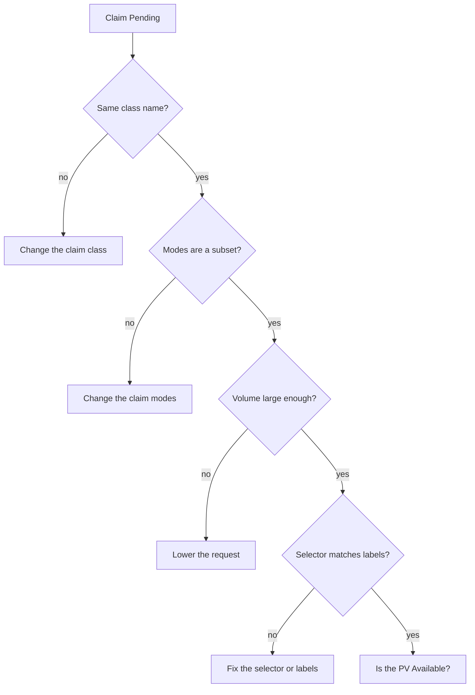

# Node Affinity, Mount Options And Pending Claims

Some storage exists on only one machine, and some storage needs special options to mount. A PersistentVolume carries this information in two fields. When a claim does not bind, the reason is almost always a mismatch that the claim events name. This part covers the two fields and then a method to find the mismatch.

## Node affinity on a volume

A volume can state which nodes may use it. The field is `spec.nodeAffinity.required.nodeSelectorTerms`, and it has the same shape as the node affinity of a Pod. The scheduler reads it. A Pod that uses a claim bound to the volume can only run on nodes that match.

A `local` volume is a directory or device on one node. For that type the field is required, because the data exists on only one node. Find the node name that you need for the match:

<!-- astrona:playground:renew -->

```sh
kubectl get nodes -o jsonpath='{.items[0].metadata.name}{"\n"}'
```

Copy the printed name. Save this as `pv-lantern.yaml` and replace `<NODE>` with that name:

```yaml
apiVersion: v1
kind: PersistentVolume
metadata:
  name: lantern
spec:
  capacity:
    storage: 300Mi
  accessModes:
  - ReadWriteOnce
  persistentVolumeReclaimPolicy: Retain
  storageClassName: local-manual
  local:
    path: /var/local/training/lantern
  nodeAffinity:
    required:
      nodeSelectorTerms:
      - matchExpressions:
        - key: kubernetes.io/hostname
          operator: In
          values:
          - <NODE>
```

Apply it:

```sh
kubectl apply -f pv-lantern.yaml
```

Then check that the volume exists:

```sh
kubectl get pv lantern -o jsonpath='{.spec.nodeAffinity.required.nodeSelectorTerms[0].matchExpressions[0].values[0]}{"\n"}'
```

The difference from `hostPath` matters. A `hostPath` volume has no node information, so the scheduler may place a Pod on a node where the path holds other data. A `local` volume tells the scheduler where the data is. The directory of a `local` volume must exist on the node before a Pod mounts it, unless the Pod or the provisioner creates it.

## Mount options

The field `spec.mountOptions` is a list of options that the kubelet passes to the mount operation. It applies to volume types that mount through the node, such as NFS (Network File System) and CSI (Container Storage Interface) volumes. Kubernetes does not check the options. An invalid option makes the mount fail when a Pod uses the volume, and the Pod shows the error as an event.

A typical entry in an NFS volume is `hard` or `nfsvers=4.1`. The field has no effect on a `hostPath` or `local` volume, so the playground cannot show it working.

## Find out why a claim is Pending

A claim with a static volume stays `Pending` while the controller finds no match. The claim itself does not say which field fails, but its events do. The claim `manifest` of the playground is such a case:

```sh
kubectl -n starfleet describe pvc manifest
```

Read the `Events` section at the end. The message says that the claim waits, and it names the class or says that no volume is available. Compare the claim with each volume, field by field. Use a table of the fields that the controller checks:

```sh
kubectl get pv -o custom-columns=NAME:.metadata.name,CLASS:.spec.storageClassName,MODES:.spec.accessModes,SIZE:.spec.capacity.storage,PHASE:.status.phase
kubectl -n starfleet get pvc manifest -o custom-columns=NAME:.metadata.name,CLASS:.spec.storageClassName,MODES:.spec.accessModes,REQUEST:.spec.resources.requests.storage
```

The claim asks for the class `archive`, the mode `ReadWriteMany` and 5Gi. The volumes offer the class `manual`, the mode `ReadWriteOnce` and at most 2Gi. Three fields fail at once, and fixing only one would leave the claim Pending.

## The mismatches that keep a claim Pending



The diagram shows the order of the checks: class, modes, size, selector and finally the phase of the volume.

Because `storageClassName`, `accessModes` and `volumeName` of a claim cannot be edited, the fix for a class or mode mismatch is to delete the claim and create it again with correct values. You can change the volume instead, but only an administrator should do that, and it affects every claim.

A claim can also be Pending because its volume is `Released`, `Failed` or `Bound` to another claim, or because the volume carries a `claimRef` for a different claim. Check `kubectl get pv` for the phase and the `CLAIM` column before you change the claim.

## Common pitfalls

> [!WARNING]
> Do not edit a Pending claim to change its class or access modes: the API server refuses it. Do not remove the `claimRef` of a Bound volume to move it: the data is still in use. A `hostPath` volume gives the scheduler no node information, so use `local` with `nodeAffinity` for data that lives on one node.
