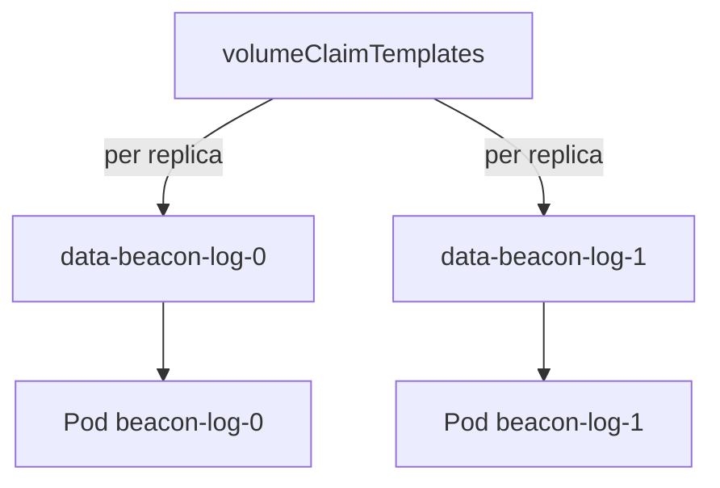

# Mount Claims In Pods, Deployments And StatefulSets

A claim does nothing until a Pod mounts it. How the workload refers to the claim decides whether replicas share data or each replica owns its own. This part shows the fields in a Pod, explains why a Deployment shares one claim, and builds a StatefulSet that creates one claim for each replica.

## The Pod fields that use a claim

A Pod uses a claim in two places. In `spec.volumes`, an entry with `persistentVolumeClaim.claimName` links a volume name to a claim in the same namespace. In a container, `volumeMounts` puts that volume at a path. The claim and the Pod must be in the same namespace, and a Pod cannot refer to a claim in another one.

Two options change how the mount behaves. `readOnly: true` on the volume entry or on the mount makes the container unable to write. `subPath` mounts one directory or file of the volume instead of its root, and it lets several containers use different folders of one claim. For a claim, `subPath` only changes which folder the container sees.

When the claim is not bound yet, the Pod stays `Pending` and the scheduler records the reason as an event. With a class that uses `WaitForFirstConsumer`, the Pod is the trigger that makes the claim bind.

## Why replicas of a Deployment share one claim

A Deployment has one Pod template. If the template names the claim `data`, every replica names the same claim. With the access mode `ReadWriteOnce`, the volume can be mounted by Pods on one node at a time, so replicas on other nodes fail to start. With `ReadWriteMany`, all replicas read and write the same files. A Deployment cannot create one claim per replica, so it suits a shared volume or a single replica.

## One claim per replica with a StatefulSet

A StatefulSet is a workload with stable Pod names, `name-0`, `name-1` and so on. It supports `volumeClaimTemplates`, a list of claim definitions. For every replica the controller creates a claim from each template and mounts it in the Pod. The claim name is the template name, the StatefulSet name and the ordinal joined with dashes: `<template>-<statefulset>-<ordinal>`.

A StatefulSet needs a headless Service, named in `spec.serviceName`, for the DNS names of its Pods. The playground has one named `beacon-log`. Save this as `statefulset-beacon-log.yaml`:

<!-- astrona:playground:renew -->

```yaml
apiVersion: apps/v1
kind: StatefulSet
metadata:
  name: beacon-log
  namespace: starfleet
spec:
  serviceName: beacon-log
  replicas: 2
  selector:
    matchLabels:
      app: beacon-log
  template:
    metadata:
      labels:
        app: beacon-log
    spec:
      containers:
      - name: writer
        image: docker.io/library/busybox:1.37.0
        command:
        - sh
        - -c
        - hostname > /data/owner; sleep 36000
        volumeMounts:
        - name: data
          mountPath: /data
  volumeClaimTemplates:
  - metadata:
      name: data
    spec:
      accessModes:
      - ReadWriteOnce
      storageClassName: standard
      resources:
        requests:
          storage: 50Mi
```

Apply it:

```sh
kubectl apply -f statefulset-beacon-log.yaml
```

Then check the Pods and the claims:

```sh
kubectl -n starfleet get pods -l app=beacon-log
kubectl -n starfleet get pvc
```

The StatefulSet controller creates the Pods one at a time, `beacon-log-0` first. The claim list shows `data-beacon-log-0` and `data-beacon-log-1` next to `old-claim`. Each Pod wrote its own host name into `/data/owner`, so the two claims hold different data.

```sh
kubectl -n starfleet exec beacon-log-1 -- cat /data/owner
```

The command prints `beacon-log-1`.

## The claims outlive the StatefulSet

The controller creates the claims, and by default it never deletes them. When you scale down or delete the StatefulSet, the Pods go and the claims stay. Delete the StatefulSet and list the claims again:

```sh
kubectl -n starfleet delete statefulset beacon-log
kubectl -n starfleet get pvc
```

`data-beacon-log-0` and `data-beacon-log-1` are still there. When you apply the same StatefulSet again, the controller finds the claims by name and mounts them, so each Pod gets its old data back. This design protects the data of a database from an accidental delete.

The field `persistentVolumeClaimRetentionPolicy` in the StatefulSet changes that behaviour. It has two settings, `whenDeleted` and `whenScaled`, and each can be `Retain` or `Delete`. Both default to `Retain`. With `whenDeleted: Delete`, the claims of all replicas are removed together with the StatefulSet. With `whenScaled: Delete`, the claims of the replicas removed by a scale down are deleted. A claim that you create yourself and name by hand is never covered by the policy.



The diagram shows that the template produces one claim per ordinal and each Pod mounts only its own claim.

## Common pitfalls

> [!WARNING]
> Deleting a StatefulSet does not delete its claims, so storage cost and old data remain until you delete them. A change to `volumeClaimTemplates` does not update claims that already exist. A claim mounted by many Pods with `ReadWriteOnce` works only while those Pods run on the same node.
