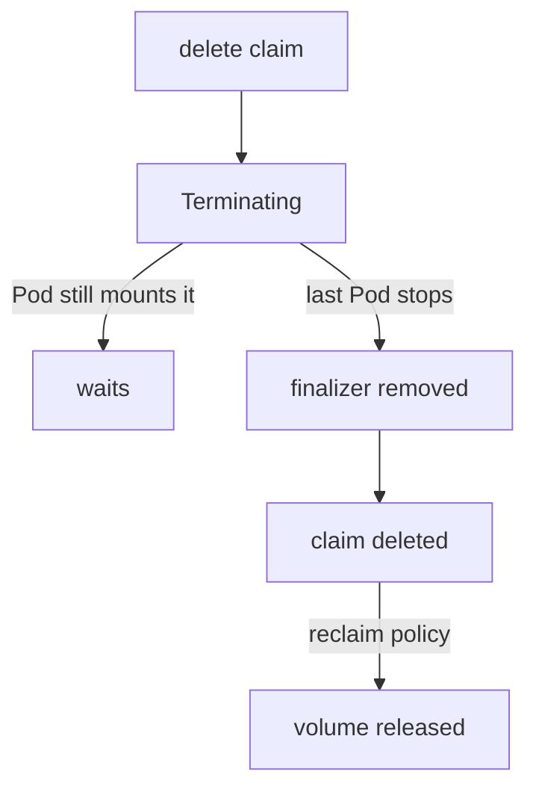

# Storage Object In Use Protection

Deleting a claim that a Pod still writes to could destroy data under a running application. Kubernetes prevents it. A delete request for such a claim succeeds on paper, but the object stays in the cluster in the status `Terminating` until the last Pod stops using it. This part explains the mechanism, shows how to find the Pod that holds a claim, and gives the order of deletion that releases it.

## Finalizers keep the object in the API

A finalizer is a string in `metadata.finalizers`. While an object has a finalizer, the API server does not remove it when you delete it. It sets `metadata.deletionTimestamp` and waits until a controller removes the finalizer. The status `Terminating` that `kubectl get` prints is this state.

Two finalizers protect storage. The finalizer `kubernetes.io/pvc-protection` sits on every claim, and the PVC protection controller removes it only when no Pod uses the claim. The finalizer `kubernetes.io/pv-protection` sits on every PersistentVolume, and the PV protection controller removes it only when the volume is not bound to a claim. Read the finalizers of the claim `old-claim`:

<!-- astrona:playground:renew -->

```sh
kubectl -n starfleet get pvc old-claim -o jsonpath='{.metadata.finalizers}{"\n"}'
```

The list contains `kubernetes.io/pvc-protection`. The Pod `holder` mounts this claim, so the protection applies.

## Delete the claim and watch it wait

Send the delete request without waiting for it to finish:

```sh
kubectl -n starfleet delete pvc old-claim --wait=false
kubectl -n starfleet get pvc old-claim
```

The claim is still listed, and its status is `Terminating`. The Pod keeps running and keeps access to its data, because nothing was unmounted. Check that the Pod can still read the file:

```sh
kubectl -n starfleet exec holder -- cat /data/state
```

The command prints `held`. A Pod that already mounts the claim is not affected by the delete request. The claim waits for the Pod.

## Find the Pod that holds a claim

Before you delete a Pod, make sure that it is the one that holds the claim. The `describe` command lists the users of a claim in the field `Used By`:

```sh
kubectl -n starfleet describe pvc old-claim
```

You can also list every Pod with the claims it mounts, which is useful in a namespace with many Pods:

```sh
kubectl -n starfleet get pods -o custom-columns=NAME:.metadata.name,CLAIMS:.spec.volumes[*].persistentVolumeClaim.claimName
```

The row for `holder` shows `old-claim`. If the Pod belongs to a Deployment or a StatefulSet, deleting only the Pod does not help: the controller creates a new Pod that mounts the claim again. In that case, scale the controller to zero or delete it first.

## Release the claim in the right order

Delete the Pod that holds the claim. The PVC protection controller then removes the finalizer and the API server removes the claim:

```sh
kubectl -n starfleet delete pod holder
kubectl -n starfleet get pvc old-claim
```

The second command returns a `NotFound` error. Now the persistent volume. When the claim goes, the volume follows the reclaim policy. The class `standard` has the policy `Delete`, so the controller of the provisioner deletes the volume and its data. The finalizer `kubernetes.io/pv-protection` makes sure that the volume object is not removed while a claim is still bound to it.



The diagram shows that the delete request starts a wait, and that the Pod, not the user, decides when the claim goes away.

## Do not remove the finalizer by hand

You can force a Terminating claim away by patching the finalizer to an empty list. Do not do it while a Pod mounts the claim. The claim object disappears, and the volume can be reclaimed while the Pod still writes to it. The right fix is always to stop the Pod. A manual patch is only acceptable when you have verified that no Pod uses the claim and the controller does not remove the finalizer.

The same protection exists on the volume side. If you delete a PersistentVolume that is still bound to a claim, the API server keeps it in the status `Terminating` because of the finalizer `kubernetes.io/pv-protection`. The volume goes away after the claim is released. You can check the finalizers of every volume at once:

```sh
kubectl get pv -o custom-columns=NAME:.metadata.name,PHASE:.status.phase,FINALIZERS:.metadata.finalizers
```

A bound volume shows `Bound` and the protection finalizer. The protection therefore works in both directions: a used claim cannot vanish, and a bound volume cannot vanish. Both rules exist so that a delete command in the wrong order cannot remove storage under a running Pod.

## Common pitfalls

> [!WARNING]
> Do not delete a Terminating claim again or patch its finalizers while a Pod mounts it. Deleting the Pod of a Deployment or StatefulSet brings a replacement that mounts the claim again. With the reclaim policy `Delete`, removing the claim also removes the data.
